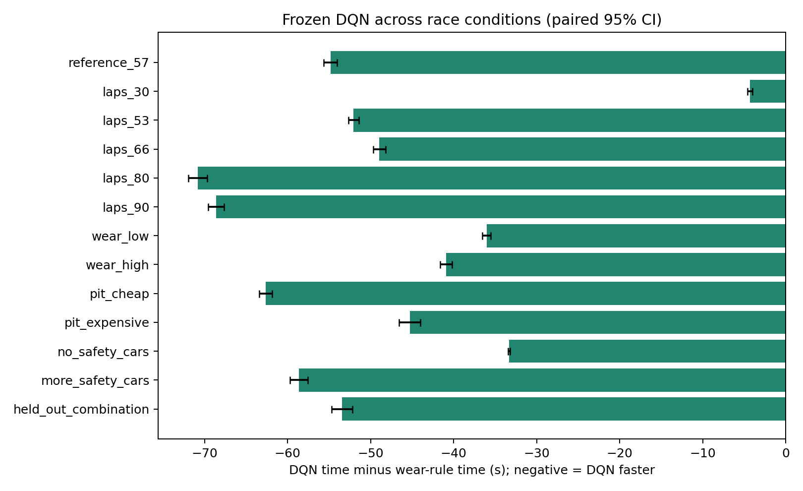
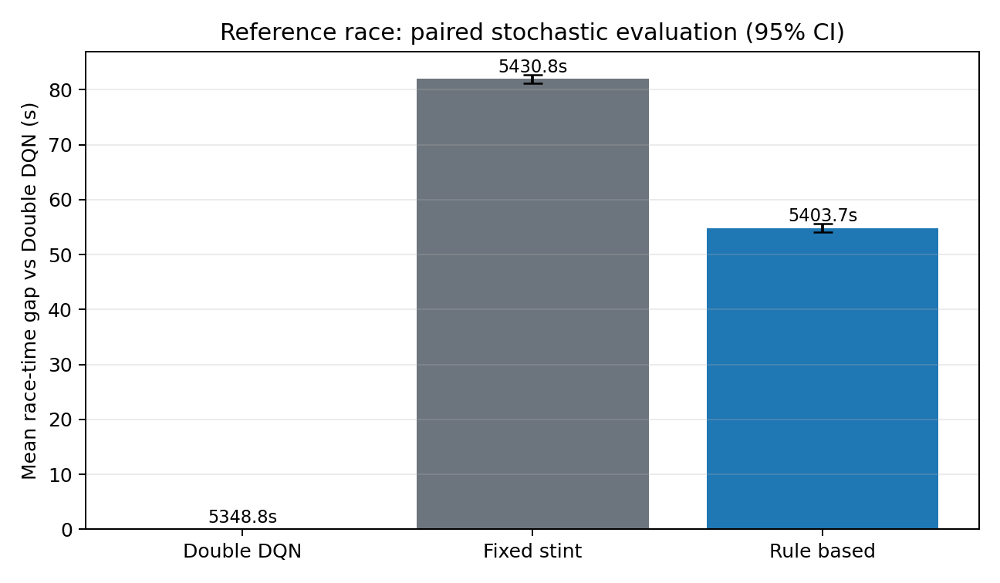
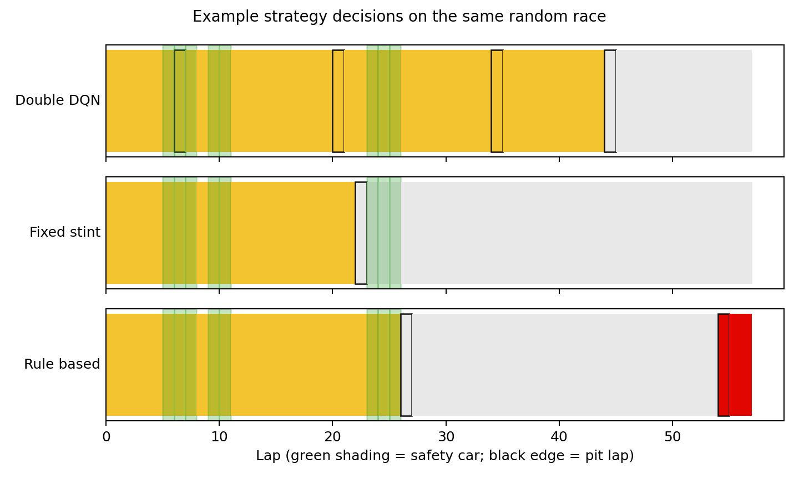
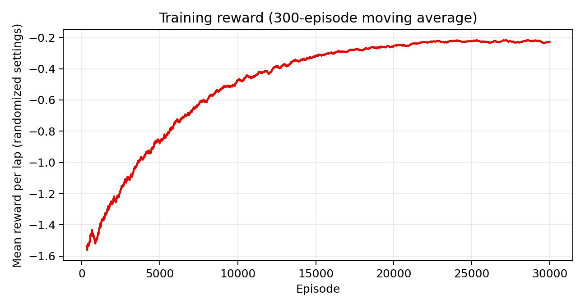

# Frozen Double DQN benchmark

The checkpoint was selected at episode 26,001 from a 30,000-episode training run, using validation races only. Training used 1,633,334 transitions. The published benchmark contains **39,000 simulated races**: 1,000 paired seeds (2,000,000–2,000,999) × 13 scenarios × 3 policies, including 13,000 DQN races. No weights were updated during evaluation.

Positive savings mean the comparator is slower than DQN. Intervals are marginal paired 95% normal-approximation intervals, not corrected for multiple comparisons.

| Scenario | DQN time (s) | Savings vs fixed stint (s) | Savings vs wear rule (s) | DQN stops | DQN compliance |
| --- | ---: | ---: | ---: | ---: | ---: |
| reference_57 | 5348.81 | 81.98 ± 0.80 | 54.85 ± 0.80 | 3.660 | 100.0% |
| laps_30 | 2781.49 | 1.15 ± 0.23 | 4.28 ± 0.31 | 1.282 | 100.0% |
| laps_53 | 4965.23 | 54.09 ± 0.64 | 52.06 ± 0.62 | 3.257 | 100.0% |
| laps_66 | 6212.54 | 165.04 ± 1.42 | 48.95 ± 0.76 | 4.519 | 100.0% |
| laps_80 | 7567.03 | 388.60 ± 2.81 | 70.82 ± 1.15 | 5.732 | 100.0% |
| laps_90 | 8537.56 | 649.25 ± 4.58 | 68.63 ± 0.95 | 6.668 | 100.0% |
| wear_low | 5321.69 | 24.13 ± 0.41 | 36.03 ± 0.50 | 3.068 | 100.0% |
| wear_high | 5373.53 | 201.11 ± 1.85 | 40.90 ± 0.70 | 4.448 | 100.0% |
| pit_cheap | 5322.17 | 99.11 ± 0.84 | 62.64 ± 0.75 | 6.386 | 100.0% |
| pit_expensive | 5377.22 | 63.09 ± 0.81 | 45.28 ± 1.28 | 2.552 | 100.0% |
| no_safety_cars | 5231.76 | 89.48 ± 0.12 | 33.32 ± 0.09 | 3.000 | 100.0% |
| more_safety_cars | 5453.66 | 70.42 ± 0.96 | 58.66 ± 1.07 | 3.919 | 100.0% |
| held_out_combination | 5939.19 | 254.29 ± 2.69 | 53.45 ± 1.23 | 3.997 | 100.0% |

53, 66 and 80 laps were excluded from both training and validation. Other rows test the reference setting, familiar horizons under fresh seeds, parameter-range boundaries, and a held-out combination. All sampled DQN races met the compound rule, but it remains a soft penalty and this is not a formal guarantee.

The fixed-stint and wear-rule policies are evaluation baselines. They use the actual race length and never generate training targets or override DQN actions. All three policies receive paired exogenous randomness.

## Reproduction and provenance

- Training: `python -m pitstoprl.train --episodes 30000 --seed 7 --env-count 16 --validate-every 2000`
- Evaluation: `python -m pitstoprl.evaluate --episodes 1000 --seed 2000000 --output-dir results/dqn`
- Checkpoint SHA-256: `1a1546889b2171b7d83426594025bd9acbf2528d5e6f4afc8d7b136fd92fc440`
- Full per-race data: [evaluation.csv](evaluation.csv)
- Metrics for every policy: [summary.json](summary.json)
- Configurations, seed split and checkpoint metadata: [protocol.json](protocol.json)
- Validation scores and model selection: [dqn_training.json](../../artifacts/dqn_training.json)

The 27-input network learns from simulator rewards; there are no expert labels or heuristic pit overrides. Historical real F1 records were not used to train or validate this model. These numbers establish performance only within this synthetic simulator.

## Figures

